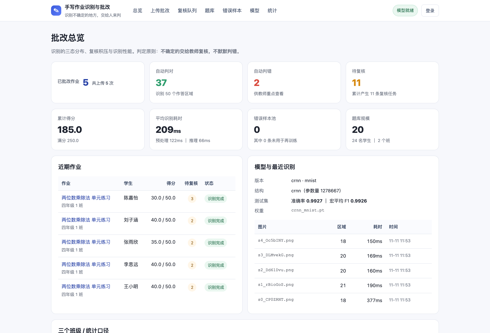
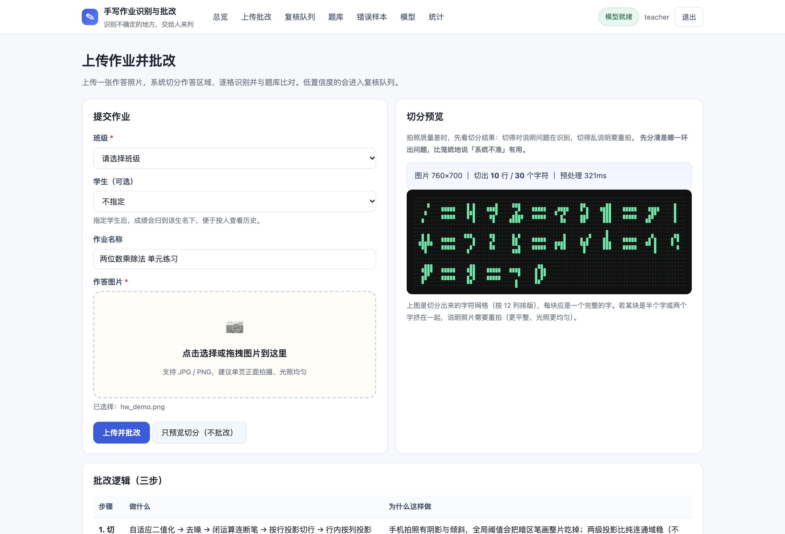
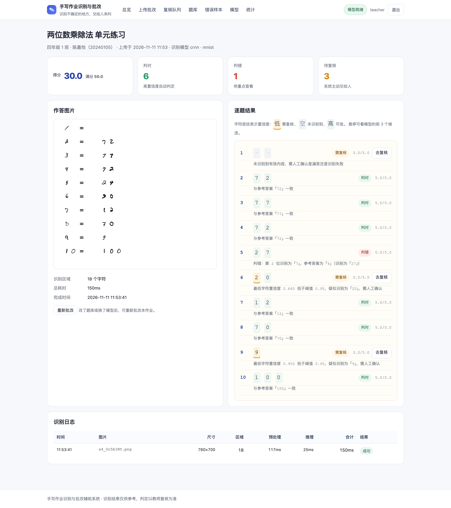
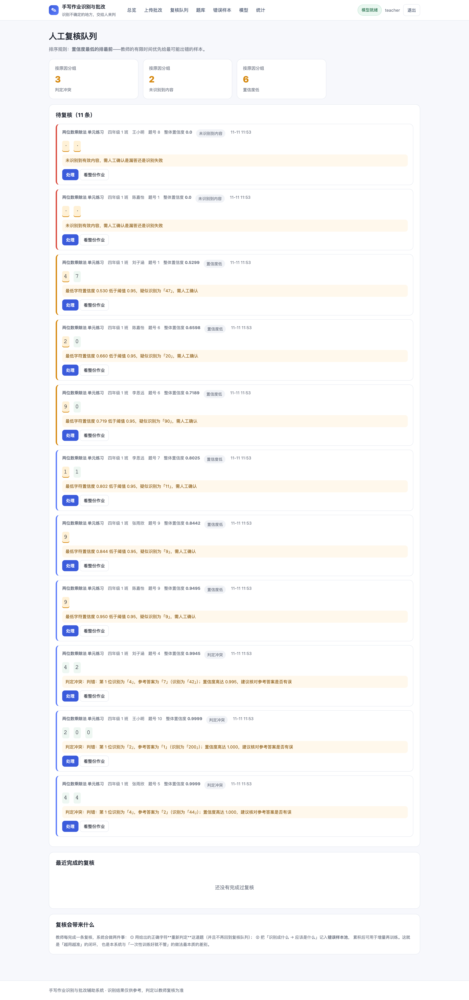
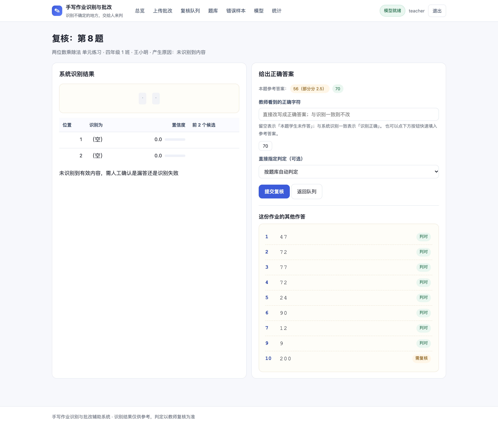
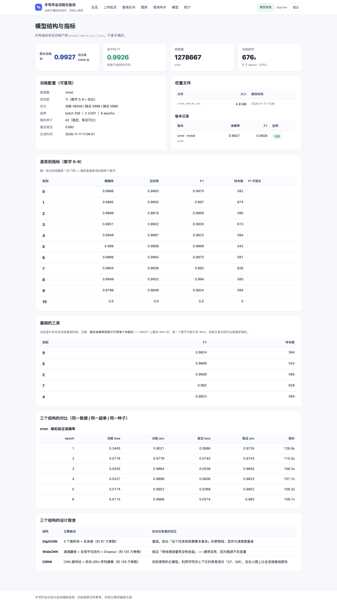

# 030 基于 PyTorch 的手写作业识别与批改辅助系统-设计展示

> **代码有偿获取 可接受定制 微信联系方式: csbysj2020 或 ACE2487，备注(BS)**

> **完整源码与全套文档 · 在线自助获取 >>> [https://mbd.pub/o/bread/YZaWlptxaw==](https://mbd.pub/o/bread/YZaWlptxaw==)**

> **成品页（功能介绍 / 更多选题）>>> [https://bishe.suilang.net/products/homework-grading](https://bishe.suilang.net/products/homework-grading)**

> 

> 

## 视频

> **点击查看 >>> [https://www.bilibili.com/video/BV1o6WL6eEYE/](https://www.bilibili.com/video/BV1o6WL6eEYE/)**

## 项目简介

本项目面向中小学教师的手写作业批改。核心定位不是「全自动批改」，而是「识别不确定的地方，交给人来判」——因为只要准确率不是 100%，就必须回答「错的那部分怎么办」。

系统实现完整链路：局部自适应二值化（应对拍照光照不均）→ 形态学闭运算（连接断笔）→ 行投影切分 → **作答区定位（剔除题号）** → 单字符归一化（重心居中到 32×32）→ CRNN 识别（逐字符置信度 + 前 3 候选）→ 答案归一化 → 三态判定。

判定结果分三态：绿色「判对」、红色「判错」（并说明错在哪一位）、黄色「需复核」（置信度低于阈值，不硬判，主动交给教师）。配合按置信度升序排列的复核队列与错误样本回收闭环，教师的纠正可导出用于增量再训练。

本仓库为**设计展示**：包含项目说明、技术架构、实验结果与运行截图；完整源码、任务书、开题报告、毕业论文与使用说明可通过上方链接自助获取，成品页可查看更多选题，也可联系微信咨询定制。

## 功能特性

1. 三态判定（核心设计）：判对 / 判错 / 需复核，置信度低于阈值一律进复核，不硬判。设计原则是「宁可让人多看一眼，不能默默判错」

2. 判定顺序不可交换：先看置信度、再看答案是否匹配。若先比答案，「识别错误导致答案不匹配」的样本会被直接判错，而它们本应交给人

3. 用 min 而非平均：一道题里只要有一个字识别错，整题答案就可能错，平均值会把单字错误稀释掉（4 个字 0.999、第 5 个 0.3，平均仍有 0.86）

4. 冲突检测：置信度 ≥0.99 却判错时转复核并提示「建议核对参考答案是否有误」——让系统反过来帮助维护题库质量

5. 作答区定位（剔除题号）：利用「题号与作答间隙远大于字符内间隙」的排版规律，实测不剔除题号时 10 道题的可用准确率为 0，剔除后为 8/10

6. 按行对位分组：一行一题。若按字符数顺序堆叠，一旦有学生漏答某题，后面所有题整体错位（实测正确题数 4/10 → 8/10）

7. 复核队列按置信度升序排列（最没把握的排最前），界面给出逐字符置信度、模型前 3 个候选与参考答案，可一键填入；纠正结果自动进入错误样本池

8. 阈值可用脚本实测标定：给出「阈值 → 复核率 / 拦截错误率 / 复核区错误密度」三条曲线，换数据后可重跑，不依赖经验值

9. 不依赖 OpenCV：二值化、形态学、切分全部用 Pillow + NumPy 实现，交付包体积小、无需编译；CPU 可训练与推理，不需要显卡

10. 53 项核心逻辑单元测试，其中 6 项是针对开发过程中真实出现过的 bug 的回归测试（闭运算极性、细笔画过滤、门槛误切、维度契约、题号排序、漏答错位）

## 技术架构

| 项目 | 说明 |
| --- | --- |
| 编程语言 | Python 3.8+ |
| 深度学习框架 | PyTorch 2.2.2（CPU 训练与推理，无需显卡） |
| 模型结构 | DigitCNN（基线）/ WideCNN（容量验证）/ CRNN（主模型，CNN + 双向 GRU） |
| 图像处理 | Pillow + NumPy（不引入 OpenCV） |
| Web 框架 | Django 4.2 |
| 数据库 | SQLite 默认（10 张表，可切 MySQL） |
| 数据规模 | MNIST 6 万训练 + 1 万测试，10 类均衡；随包提供可离线训练 |
| 性能参考 | 单张作业识别 150~255ms（预处理约 120ms + 推理约 40ms）；训练 CRNN 676 秒 / DigitCNN 1668 秒 / WideCNN 约 7500 秒（均 CPU） |
| 启动方式 | 双击启动脚本，或 python3 manage.py runserver |

## 目录结构

以下为完整交付版的结构（本仓库仅作设计展示）：

```
homework-grading/
└── （目录树待补）
```

## 数据集、实验与三个发现

| 指标 | 结果 |
| --- | --- |
| 数据集 | MNIST 6 万训练 + 1 万测试（随包提供，可离线训练） |
| 主模型 | CRNN（CNN + 双向 GRU），1,278,667 参数 |
| 测试集准确率 | **0.9927** ｜ 宏平均 F1 **0.9926** |
| 训练耗时 | CPU 676 秒（6 轮 / 48,008 张） |
| 阈值标定 | 阈值 0.95 时复核率 2.28%、**拦截错误率 81.82%** |
| 单元测试 | 53 项全部通过（含 6 项真实 bug 的回归测试） |

**发现一：参数量既不预测速度、也不预测准确率。** 三个结构在同一数据与超参下训练：DigitCNN（66.7 万参数）准确率 0.9935、CRNN（127.9 万）0.9927，差距 0.0008 小于一个标准误，属统计噪声；而训练耗时相差近 12 倍（275 秒 / 1250 秒 / 108 秒）——瓶颈在卷积通道数与收紧层的算子形态，不在参数量。

**发现二：整体准确率会掩盖类别问题。** 整体 0.9927 时，数字 9 的 F1 只有 0.9824，混淆分析显示最高频的混淆对是 4→9、3→5、7→9。补样本应定向补这几类，而不是盲目扩大数据集。

**发现三：作答区定位比识别模型更关键。** 作业每行左边是题号、右边才是作答。不剔除题号时，识别结果会变成「547」而不是「47」——10 道题的可用准确率是 **0**；剔除后是 8/10。一个准确率 0.9927 的模型，如果输入里混了题号，实际可用准确率就是 0。

**验证：没有任何一题被默默判错。** 在含 1 处答错 + 1 处漏答的答卷上，10 道题里 8 题自动判对，答错的与漏答的两处都主动进了复核队列，判错 0 题。系统的能力边界对使用者是透明的。

## 交付内容

1. 完整源码（Django 工程、预处理链路、三个模型结构、三态判定层、9 个页面）
2. 训练好的模型权重（crnn_mnist.pt，随包提供，开箱即用，也可自己重训）
3. MNIST 数据集（随包提供，可离线训练，无需联网）
4. 毕业设计任务书（Word）、开题报告（Word）
5. 毕业论文（Word，七章制，含阈值标定实验、消融实验与错误分析）
6. 系统使用与二次开发说明（Word + md，14 节，含调参指引与常见报错处理）
7. 阈值标定脚本（tools/calibrate_threshold.py）
8. 53 项核心逻辑单元测试（含 6 项真实 bug 的回归测试）
9. 运行截图 6 张 + 论文配图 6 张 + 功能演示视频（91 秒，带中文旁白）

## 常见问题

**和「拍张照自动批改」有什么区别？**

区别在于**承认系统会出错**，并为出错的样本设计了处置流程。手写识别早就超过 99% 了，但真到教室里用会碰到两个问题：① 剩下那不到 1% 的错误，如果系统悄悄判错了，学生会拿不到应得的分，或者被冤枉；② 模型的置信度经常跟真实正确率不匹配，可能以 0.99 的置信度给出错误答案。所以本系统把每道题的结论分成三态：判对 / 判错 / **需复核**。拿不准的一律交给人，不硬判。

**阈值 0.95 是怎么定的？有什么依据？**

用测试集实测标定的，不是拍脑袋。在 5996 张测试集上跑了「阈值 → 复核率 / 拦截错误率」曲线：阈值 0.80 时复核率 1.08% 但只拦下 54.55% 的错误；提到 0.95，复核率只涨到 2.28%，拦截率却升到 81.82%——每多看一条就能多挡下不少误判，这笔交换明显划算。再往上到 0.98，复核量涨 52% 而拦截率只多 4.5 个点，边际收益就薄了。项目提供标定脚本，换成真实作业数据后应重跑（真实数据的最优点通常比 0.95 更低）。

**为什么要用 min 而不是平均置信度？**

因为一道题里只要有一个字识别错了，整题答案就可能是错的。平均值会把单个错误字符的严重性稀释掉——比如 4 个字符置信度都是 0.999、第 5 个只有 0.3，平均仍有 0.86，用平均值判定就会放过这道题。

**「作答区定位」是什么？为什么重要？**

作业每行左边是题号、右边才是作答。如果整行丢给模型识别，结果会把题号也读进来——「12 + 35 = 47」会得到「547」而不是「47」。实测：不剔除题号时，10 道题的可用准确率是 **0**；剔除后是 8/10。一个准确率 0.9927 的模型，如果输入里混了题号，实际可用准确率就是 0。

**三个模型哪个最好？**

准确率上三个打平（0.9935 / — / 0.9927，差距小于一个标准误，属统计噪声）。但训练耗时相差近 12 倍：CRNN 最快（单轮 108 秒），DigitCNN 275 秒，WideCNN 约 1250 秒。综合来看选 CRNN——准确率相当、训练最快，而且它输出逐位分类结果，可解释性更好（能直接对应「哪一格错了」）。

**为什么不用 CTC 做端到端识别？**

作业作答是「一格一字」的印刷体式书写，字符切分由预处理确定，不需要 CTC 来处理「不定长序列与标签的对齐」。更重要的是，逐位分类的结果**可以直接对应到「具体哪一格错了」**，便于生成「第 2 位识别为 7，参考答案为 4」这样的可解释反馈；CTC 的对齐关系很难向教师解释。

## 截图







